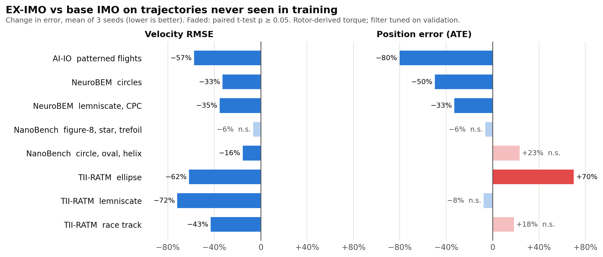

# EX-IMO: Extended Model-Based Learned Inertial Model Odometry
[Arxiv Paper](https://arxiv.org/pdf/2611.09584)
[](https://www.youtube.com/watch?v=IsjZ-TeqXPM)

EX-IMO extends **Learned Inertial Model Odometry (IMO)** (Cioffi et al., RA-L 2023) for quadrotors. IMO is an EKF
whose updates come from a temporal convolutional network (TCN) that predicts the 0.5 s displacement from IMU and
thrust inputs. EX-IMO:

- predicts the displacement in the **body frame** instead of the world frame, so the network can't depend on absolute
  heading;
- adds a **torque** input (J⁻¹τ), either from the gyro (`Jω̇ + ω×Jω`) or from the rotor signals (a per-platform
  allocation fitted on training data);
- replaces the thrust from inverse dynamics with a **collective thrust fitted from rotor signals**, which can be
  computed in flight without the label.

This repository holds the code, the data pipeline, the experiment protocol and the results that compare EX-IMO with
base IMO on four public UAV datasets (AI-IO, NanoBench, TII-RATM, NeuroBEM), plus the trained weights.
It builds on the [IMO code](https://github.com/uzh-rpg/learned_inertial_model_odometry) by UZH RPG; its original
README is in [docs/IMO_UPSTREAM_README.md](docs/IMO_UPSTREAM_README.md).

**Paper abstract.** Inertial odometry is a compelling approach to state estimation for agile quadrotor flight due to
its affordability, low weight, and robustness to perceptual degradation. However, relying only on integrated inertial
measurements is impractical, as sensor errors and time-varying biases lead to significant pose drift. Although recent
advances have enabled inertial odometry for drone racing, existing approaches show limited generalization to
trajectories not seen during training. This work improves generalization by adopting a body-frame representation and
incorporating body-frame torque dynamics into the learning pipeline. The learned model predicts short-horizon relative
displacements, which are fused with IMU measurements in an Extended Kalman Filter. Experimental results show that the
proposed method outperforms the previous state-of-the-art learned inertial odometry approach for quadrotor pose
estimation on unseen trajectories.

The results below are this repository's own evaluation on four public datasets, not the paper's experiments.

## Results in brief

<picture>
  <source media="(prefers-color-scheme: dark)" srcset="docs/figures/heldout_dark.png">
  
</picture>

On trajectories never seen in training, EX-IMO with rotor-derived torque lowers velocity error in all 8 held-out sets
(7 significant at p < 0.05) and position error in 5 of 8 (3 significant); TII-RATM's ellipse is the one significant
loss. The tables below give the absolute numbers; `scripts/plots/heldout_plot.py` redraws the figure from them.

All numbers come from the cleaned data this repo builds (`data_prep/`), so they aren't directly comparable with
numbers published on the original files. Each figure is a mean over 3 seeds; the filter is tuned on validation for
each dataset and variant; p comes from a paired t-test across seeds. Full tables: [results/ex_imo/](results/ex_imo/);
discussion and caveats: [docs/EX_IMO.md](docs/EX_IMO.md).

**Same tracks (stage 1), filter velocity RMSE [m/s]:**

| dataset, split | base IMO | EX-IMO, gyro τ | EX-IMO, rotor τ |
|---|---|---|---|
| TII-RATM test | **0.516** | 0.773 (+50%) | 0.721 (+40%, p 0.02) |
| NanoBench test | 0.479 | 0.458 (−4%) | **0.378** (−21%, p 0.004) |
| NeuroBEM test | 0.895 | 1.012 (+13%) | **0.838** (−6%, p 0.051) |
| AI-IO test | 1.384 | 1.420 (+3%) | **0.519** (−63%, p 3e-4) |
| AI-IO patterned flights, never trained on | 1.082 | 1.114 (+3%) | **0.461** (−57%, p 8e-4) |

**Held-out shapes (stage 3)**, base IMO → EX-IMO with rotor τ. Each fold leaves a group of trajectory shapes out of
training, validation and the physics fits.

| held-out shapes | velocity RMSE [m/s] | ATE after SE(3) alignment [m] |
|---|---|---|
| TII ellipse | 5.73 → 2.19 (−62%, p 0.04) | 4.97 → 8.44 (+70%, p 0.03) |
| TII lemniscate | 6.55 → 1.84 (−72%, p 0.001) | 10.4 → 9.61 (−8%, p 0.25) |
| TII RATM track | 8.46 → 4.81 (−43%, p 0.01) | 16.9 → 20.0 (+18%, p 0.27) |
| NanoBench figure-8, star, trefoil | 0.609 → 0.569 (−6%, p 0.10) | 1.93 → 1.81 (−6%, p 0.28) |
| NanoBench circle, oval, helix | 0.557 → 0.471 (−16%, p 0.006) | 1.33 → 1.63 (+23%, p 0.08) |
| NeuroBEM circles | 0.777 → 0.522 (−33%, p 0.002) | 2.39 → 1.21 (−50%, p 0.003) |
| NeuroBEM lemniscate and CPC | 1.111 → 0.718 (−35%, p 0.005) | 4.11 → 2.76 (−33%, p 0.03) |

What these show:

- **Only rotor-derived torque helps.** The gyro-derived torque `Jω̇ + ω×Jω` is a function of the gyro history the
  network already sees, and gives no gain. The rotor torque carries velocity information: on its own, it explains
  body-frame displacement with R² up to 0.94 (`scripts/diag/rotor_gain_check.py`). The likely cause, not verified, is
  the rotors trimming against aerodynamic moments that grow with airspeed. All four datasets are indoor; wind would
  decouple airspeed from ground speed.
- **On held-out shapes, EX-IMO has the lower velocity error in all 7 folds; position error is mixed (4 of 7).**
  NeuroBEM, the fold set with the most data, is the clearest case. TII has 6 training flights per fold and neither
  model generalises across its tracks.
- **Base IMO memorises track headings:** rotating the TII flights 90° in yaw raises its validation error from 0.34 to
  5.8 m/s, while body-frame models don't change.

## Repository layout

```
data_prep/         download, clean and resample the public datasets (fetch_datasets.sh, clean_datasets.py, public_uav.py)
src/               IMO network and EKF, with the EX-IMO changes (frame, torque, body-frame update)
  train_ex.py        training
  main_filter.py     EKF with network updates
  learning/data_management/prepare_datasets/public_uav_imo.py   converter to IMO's format + thrust/torque fits + folds
scripts/           filter tuning and test (select_and_test.py), tables (compare_stage.py), figures (plots/), job queue, diagnostics
config/            fitted physics per dataset and fold, NeuroBEM gyro scale
results/ex_imo/    result tables and the filter settings chosen on validation
docs/              EX_IMO.md (method decisions, results, caveats), CLEANING.md (data cleaning rules)
tests/             filter Jacobians, frames, oracle runs, metrics, folds
```

`datasets/Blackbird`, `results/Blackbird` and `conda_environment.yaml` are upstream IMO's Blackbird example and
environment, kept for reference; the Docker image is the environment used here.

## Setup

Requirements: Docker and, for training, an NVIDIA GPU with a recent driver (CPU works for everything else).

```bash
docker/build.sh                                   # builds ex-imo:latest (Python 3.10, PyTorch 2.11 CUDA 12.8)
export EXIMO_DATA=$HOME/eximo_data                # downloads and cleaned copies, about 16 GB
export EXIMO_OUT=$HOME/eximo_out                  # converted data (1.1 GB with the folds) and results
```

Run every command below from the repository root. They run in the container through `docker/run.sh`, which mounts the repo, `$EXIMO_DATA` and
`$EXIMO_OUT`. It runs on CPU by default; prefix a command with `EXIMO_GPU=1` for the GPU. `pytest` should pass:
`docker/run.sh python3 -m pytest tests -q`.

## Reproduce the results

**1. Download** AI-IO, NanoBench, TII-RATM (the non-image files) and NeuroBEM, about 3.2 GB of transfer. Sizes are
checked against the values recorded at our download (2026-10-14); `data_prep/manifest.json` lists sources, versions
and checksums.

```bash
docker/run.sh bash data_prep/fetch_datasets.sh
```

**2. Clean.** This only removes data: duplicate recordings, samples the datasets' own resamplers filled in, and gaps
in the ground truth. The rules and every affected file are in [docs/CLEANING.md](docs/CLEANING.md);
`data_prep/cleaning_log_reference.json` is our log, to compare with yours.

```bash
docker/run.sh python3 data_prep/clean_datasets.py
```

**3. Resample to 100 Hz and split** NanoBench, TII-RATM and NeuroBEM into IMO's HDF5 format. AI-IO is already in
that format. `public_uav.py` documents the split rules.

```bash
docker/run.sh python3 data_prep/public_uav.py --dataset all
```

**4. Convert for IMO/EX-IMO.** This fits each platform's thrust map and torque allocation on its training split
(written to `config/physics/`) and writes the inputs. `--folds` writes the held-out-shape folds of stage 3, with the
fits redone without the held-out flights.

```bash
docker/run.sh python3 src/learning/data_management/prepare_datasets/public_uav_imo.py --dataset all
docker/run.sh python3 src/learning/data_management/prepare_datasets/public_uav_imo.py --dataset all --folds
```

**5. Train.** One run:

```bash
EXIMO_GPU=1 docker/run.sh python3 src/train_ex.py --root_dir $EXIMO_OUT/data --dataset tii_ratm \
    --frame body --torque rotor --seed 42 --out_dir $EXIMO_OUT/results/s1/tii_ratm/body_rotor/seed42
```

A whole stage (stage 1: 36 runs; stage 3: 42 runs, after stage 1 has been selected, step 6):

```bash
docker/run.sh python3 scripts/jobs/make_jobs.py s1          # writes $EXIMO_OUT/jobs/s1_train.txt
scripts/run_queue.sh $EXIMO_OUT/jobs/s1_train.txt 1          # on the host (needs nvidia-smi); one GPU job at a time; resumable
```

Runs stop early after 60k steps without validation improvement. On one recent GPU, a run takes 4–25 minutes.

**6. Tune the filter on validation, then test** (CPU). The rules were fixed before any test result was seen, and
are in the script's docstring.

```bash
docker/run.sh python3 scripts/select_and_test.py --stage s1 --dataset tii_ratm --jobs 8
docker/run.sh python3 scripts/select_and_test.py --stage s3 --dataset neurobem__circles --variants world_none body_rotor
docker/run.sh python3 scripts/compare_stage.py --stage s1 --dataset tii_ratm
```

Datasets: `ai_io`, `nanobench`, `tii_ratm`, `neurobem`. Folds: `tii_ratm__{ellipse,lemniscate,trackRATM}`,
`nanobench__{crossing,round}`, `neurobem__{circles,lemniscate_cpc}`.

## Pretrained weights

[Ex-IMO-weights-v1.0.zip](https://github.com/SasaKuruppuarachchi/Ex-IMO/releases/download/v1.0/Ex-IMO-weights-v1.0.zip)
(GitHub release v1.0) holds 12 models: base IMO, EX-IMO with gyro τ, and EX-IMO with rotor τ (recommended), for
each dataset. Each is the stage 1 seed with the lowest validation loss. Every folder has the weights, the model
parameters, the platform's physics fit, the filter setting tuned on validation, and its test metrics; `MODELS.md`
lists them. After steps 1–4, unzip it into `$EXIMO_OUT` (the container only sees the repo, `$EXIMO_DATA` and
`$EXIMO_OUT`), then:

```bash
unzip Ex-IMO-weights-v1.0.zip -d $EXIMO_OUT
docker/run.sh python3 scripts/run_released.py --model $EXIMO_OUT/Ex-IMO-weights-v1.0/tii_ratm/body_rotor \
    --dataset tii_ratm --list test --out $EXIMO_OUT/released/tii_ratm
```

The models only fit the platform they were trained on: inputs are scaled by that platform's thrust map and torque
allocation. On another vehicle, refit those (step 4) and retrain.

## Datasets and licenses

| dataset | source | license |
|---|---|---|
| AI-IO | [SJTU-ViSYS-team/AI-IO](https://github.com/SJTU-ViSYS-team/AI-IO) | MIT (repository; no separate data license) |
| NanoBench | [syediu/nanobench](https://github.com/syediu/nanobench) | BSD-3-Clause |
| TII-RATM | [tii-racing/drone-racing-dataset](https://github.com/tii-racing/drone-racing-dataset) | data CC BY 4.0, code MIT |
| NeuroBEM | [download.ifi.uzh.ch/rpg/NeuroBEM](https://download.ifi.uzh.ch/rpg/NeuroBEM/) | none stated; check with the authors before redistributing |

This repository doesn't redistribute any data. The released weights were trained on these datasets; cite them when
you use the weights.

## Citation

If you find this work useful, please cite EX-IMO and IMO, on which it builds:

```bibtex
@article{KuruppuArachchige2026EXIMO,
  author  = {Kuruppu Arachchige, Sasa and Kämäräinen, Joni},
  title   = {Extended Model Based Learned Inertial Odometry},
  journal = {ICUAS},
  year    = {2026}
}

@article{CioffiRal2023,
  author  = {Cioffi, Giovanni and Bauersfeld, Leonard and Kaufmann, Elia and Scaramuzza, Davide},
  title   = {Learned Inertial Odometry for Autonomous Drone Racing},
  journal = {IEEE Robotics and Automation Letters (RA-L)},
  year    = {2023}
}
```

## Credits and license

Built on [IMO](https://github.com/uzh-rpg/learned_inertial_model_odometry) (GPL-3.0), which uses
[TLIO](https://github.com/CathIAS/TLIO) and the
[RPG trajectory evaluation toolbox](https://github.com/uzh-rpg/rpg_trajectory_evaluation).
Released under the GNU GPL v3.0, as the original; see [LICENSE](LICENSE).
